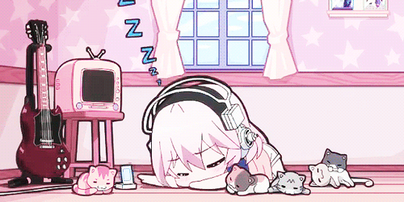

# frenlick

Founder and maintainer of [ThePlaytimeFoundation](https://github.com/ThePlaytimeFoundation).

---

## About

I run ThePlaytimeFoundation, an open source organization where people contribute to large-scale projects. I maintain the organization and its repositories.

---

## ThePlaytimeFoundation

A leading open source organization built for contributors who want to work on vast, long-running projects.

- **Organization:** [github.com/ThePlaytimeFoundation](https://github.com/ThePlaytimeFoundation)
- **Role:** Founder and maintainer
- **Focus:** Open source projects at scale

---

## Contact

- GitHub: [@frenlick](https://github.com/frenlick)
- Organization: [ThePlaytimeFoundation](https://github.com/ThePlaytimeFoundation)
